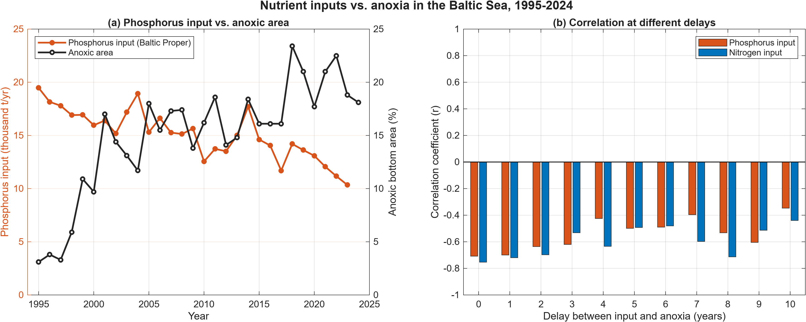

# Baltic-Sea-Hypoxia
*Work in progress*

## Overview

This project investigates why hypoxia (low oxygen) has persisted in the Baltic Proper, the large central basin of the Baltic Sea, despite the long-term efforts to reduce nitrogen and phosphorus inputs. These nutrients enter the sea mainly through rivers that carry agricultural runoff/wastewater, as well as through atmospheric deposition.

By comparing long-term nutrient input data with changes in the area affected by hypoxia and anoxia, this project examines why oxygen conditions have not recovered wheras nutrient inputs have decreased.

The goal is to turn long-term Baltic Sea monitoring data into a small number of clear, evidence-based findings using data analysis and visualizations in MATLAB.

## Planned analysis

1. Nitrogen and phosphorus inputs to the Baltic Sea over time
2. Hypoxic and anoxic bottom area over time
3. Nutrient inputs vs. hypoxia, to test for a relationship or a time delay

## Results

### 1. Nutrient inputs to the Baltic Proper

*Normalized total (waterborne + airborne) inputs of nitrogen and phosphorus to the Baltic Proper. Dashed lines show HELCOM's maximum allowable inputs. Data: HELCOM (2026).*

- **Phosphorus** inputs fell by about 47%, from roughly 19,500 tonnes in 1995 to 10,300 tonnes in 2023.
- **Nitrogen** inputs fell by about 22% between 1995 and 2009, but have stayed close to 400,000 tonnes per year since then.
- Both nutrients are still above HELCOM's targets for the Baltic Proper.

### 2. Low-oxygen area on the seafloor

*Share of the bottom area in the Baltic Proper, Gulf of Finland and Gulf of Riga with hypoxia (oxygen below 2 ml/l, including anoxic areas) or anoxia (no oxygen, hydrogen sulphide present), autumn 1960-2024. Yearly values were read from Figure 3 of Hansson & Viktorsson (2025, SMHI) using WebPlotDigitizer and are accurate to about ±1 percentage point. No data for 1961 and 1967.*

- Before 1999, hypoxia covered on average about 22% of the bottom area whereas anoxia about 6%.
- After the 1999 regime shift, average hypoxia rose to about 30%, and the anoxic area almost tripled, to about 17%.
- In 2024, 34% of the bottom area was hypoxic, one of the highest values since 1960 and 18% was anoxic.
- Oxygen conditions became worse during the same years that phosphorus inputs fell (Graph 1), so lower nutrient inputs have not yet been followed by a recovery.

### 3. Nutrient inputs vs. anoxia

*(a) Normalized phosphorus input to the Baltic Proper (left axis) and anoxic share of the bottom area (right axis). (b) Correlation coefficient (r) between nutrient inputs L years earlier and the anoxic area, for delays of 0-10 years. Results are saved in `data/processed/lag_correlation.csv`.*

- Between 1995 and 2023, phosphorus inputs fell by almost half, while the anoxic area grew from about 3% to about 18% of the seafloor.
- The correlation is negative at every delay from 0 to 10 years (r = -0.35 to -0.71 for phosphorus, -0.44 to -0.75 for nitrogen). In other words, lower inputs have not been followed by a smaller anoxic area, even after 10 years.
- This suggests that the response of the sea to lower inputs takes longer than 10 years, or that other processes are keeping anoxia high.

## Discussion: why hasn't oxygen recovered?

**1. The sediments release phosphorus (internal loading).** In oxygenated water, phosphate binds to insoluble iron(III) oxides in the sediment. When bottom water becomes anoxic, Fe(III) is reduced to soluble Fe(II), and the phosphate bound to it is released back into the water (Conley et al., 2009). So the growing anoxic area (Graph 2) can itself supply phosphorus, which works against the cuts in external inputs (Graph 1). This creates a feedback loop: more anoxia → more phosphorus released → more algae → more decomposition → more anoxia.

**2. Nitrogen fixation.** The extra phosphorus favours cyanobacteria, which can fix nitrogen gas (N₂) from the air. This adds nitrogen to the sea independently of river inputs, and may help explain why nitrogen levels remain high even though nitrogen inputs have been flat since about 2009 (HELCOM, 2026).

**3. A long legacy of pollution.** Riverine phosphorus loads to the Baltic Proper roughly tripled between 1950 and 1970, from about 6,500 to 18,700 tonnes per year (Savchuk et al., 2012). Decades of high inputs built up a large store of nutrients in the water and sediments, which takes a long time to be removed.

**4. Physical conditions.** The Baltic Sea exchanges water with the North Sea only through narrow, shallow straits, and a strong salinity layering limits mixing between surface and bottom water. Deep water is renewed mainly by occasional inflows of salty, oxygen-rich North Sea water (Hansson & Viktorsson, 2025), which this analysis does not include.

## Limitations

- Oxygen values were read from a published figure with WebPlotDigitizer and are accurate to about ±1 percentage point.
- Nutrient inputs cover the Baltic Proper only, while the oxygen data also include the Gulf of Finland and the Gulf of Riga.
- Only 29 years overlap (1995-2023), so delays longer than about 10 years cannot be tested, and the correlations are dominated by the opposite long-term trends of the two datasets.
- Correlation does not show cause and effect. Saltwater inflows, temperature and other factors were not included.

## Conclusion

Phosphorus inputs to the Baltic Proper have been cut by almost half since 1995, but the area of seafloor without oxygen has roughly tripled since the late 1990s. The data show no recovery within a 10-year delay. This is consistent with internal phosphorus release from anoxic sediments and the long legacy of past pollution, which mean the Baltic Sea is likely to respond to lower inputs only slowly, over decades.

## How to reproduce

1. Download or clone this repository.
2. Open MATLAB and run the scripts in the `scripts/` folder:
   - `plot_nutrients.m` → Graph 1
   - `plot_hypoxia.m` → Graph 2
   - `plot_nutrients_vs_hypoxia.m` → Graph 3
3. Each script reads its data from `data/processed/` and saves its figure to `figures/`.
