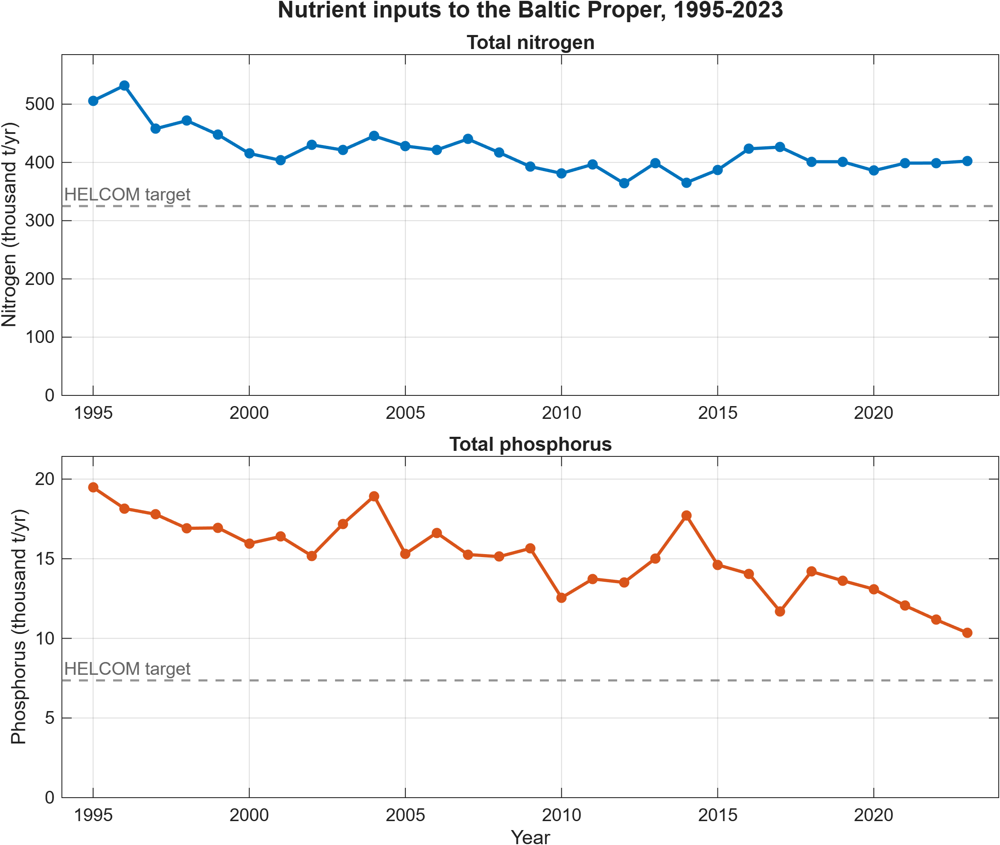
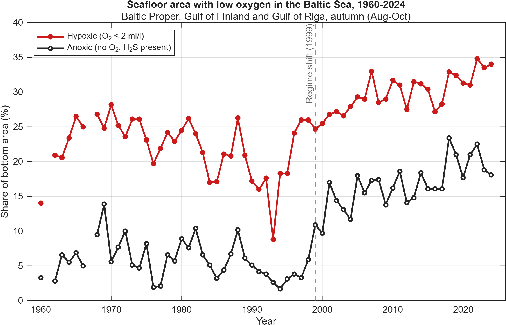

# Baltic-Sea-Hypoxia
*Work in progress*

## Overview

This project investigates why hypoxia (low oxygen) has persisted in the Baltic Proper, the large central basin of the Baltic Sea, despite the long-term efforts to reduce nitrogen and phosphorus inputs. These nutrients enter the sea mainly through rivers that carry agricultural runoff/wastewater, as well as through atmospheric deposition.

By comparing long-term nutrient input data with changes in the area affected by hypoxia and anoxia, this project examines why oxygen conditions have not recovered wheras nutrient inputs have decreased.

The goal is to turn long-term Baltic Sea monitoring data into a small number of clear, evidence-based findings using data analysis and visualizations in MATLAB.

## Planned analysis

1. Nitrogen and phosphorus inputs to the Baltic Sea over time
2. Hypoxic and anoxic bottom area over time
3. Nutrient inputs vs. hypoxia, to test for a relationship or a time delay

## Results

### 1. Nutrient inputs to the Baltic Proper

*Normalized total (waterborne + airborne) inputs of nitrogen and phosphorus to the Baltic Proper. Dashed lines show HELCOM's maximum allowable inputs. Data: HELCOM (2026).*

- **Phosphorus** inputs fell by about 47%, from roughly 19,500 tonnes in 1995 to 10,300 tonnes in 2023.
- **Nitrogen** inputs fell by about 22% between 1995 and 2009, but have stayed close to 400,000 tonnes per year since then.
- Both nutrients are still above HELCOM's targets for the Baltic Proper.

### 2. Low-oxygen area on the seafloor

*Share of the bottom area in the Baltic Proper, Gulf of Finland and Gulf of Riga with hypoxia (oxygen below 2 ml/l, including anoxic areas) or anoxia (no oxygen, hydrogen sulphide present), autumn 1960-2024. Yearly values were read from Figure 3 of Hansson & Viktorsson (2025, SMHI) using WebPlotDigitizer and are accurate to about ±1 percentage point. No data for 1961 and 1967.*

- Before 1999, hypoxia covered on average about 22% of the bottom area, and anoxia about 6%.
- After the 1999 regime shift, average hypoxia rose to about 30%, and the anoxic area almost tripled, to about 17%.
- In 2024, 34% of the bottom area was hypoxic, one of the highest values since 1960, and 18% was anoxic.
- Oxygen conditions became worse during the same years that phosphorus inputs fell (Graph 1), so lower nutrient inputs have not yet been followed by a recovery.
